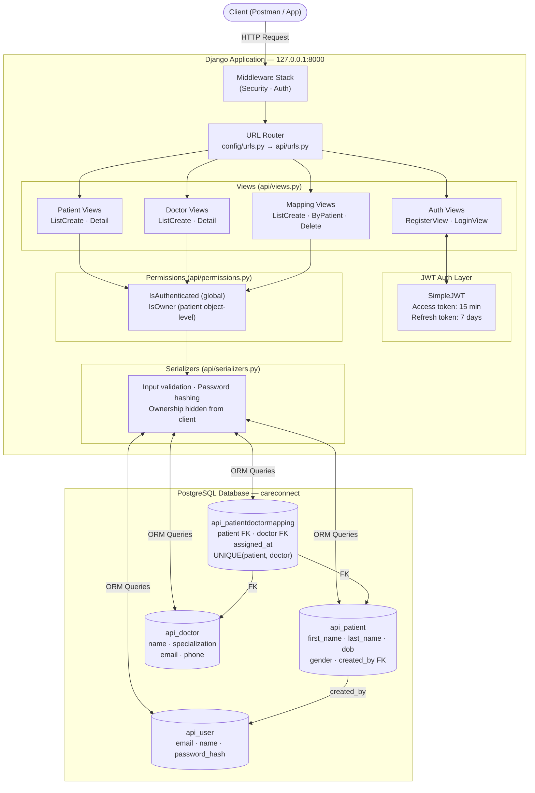
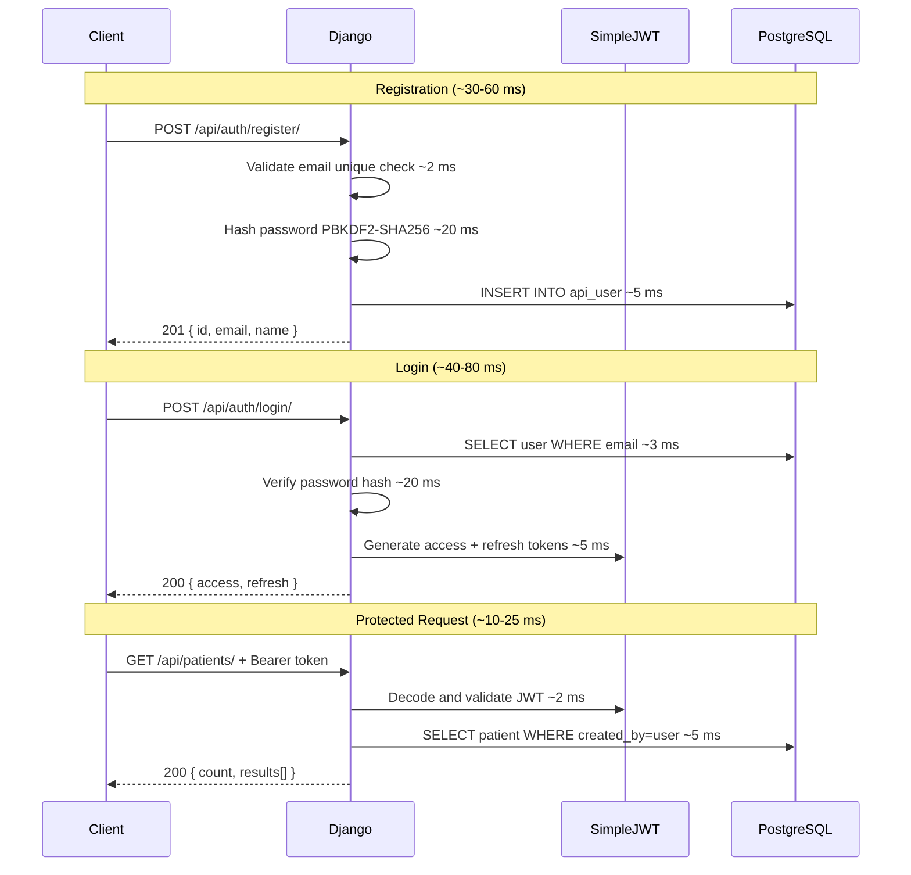
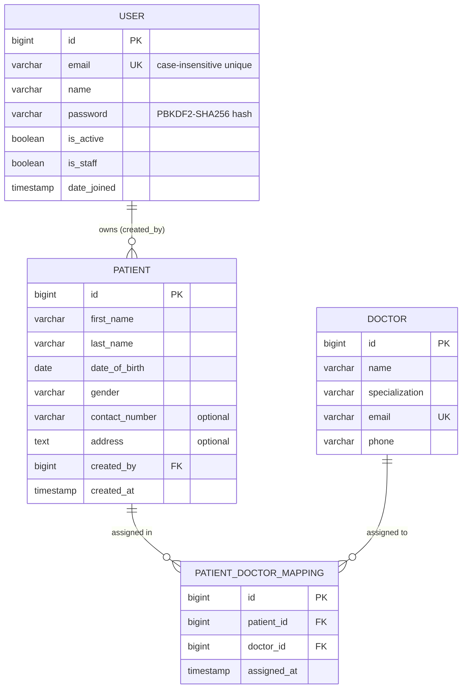

# CareConnect API

A RESTful healthcare backend built with Django REST Framework and PostgreSQL. It handles JWT-based user authentication, patient record management with strict per-user ownership, a shared doctor directory, and patient-doctor assignment with database-level duplicate prevention.

**What makes this project stand out:** Email is used as the login identifier instead of username — requiring a custom User model defined before the first migration. Patient ownership is enforced at the queryset level (not just object-level), so a user cannot even discover another user's patient ID — the response is always 404. Duplicate doctor assignments are blocked by both serializer validation and a `UNIQUE(patient, doctor)` database constraint, meaning even a race condition cannot create a duplicate. Passwords go through Django's full validator pipeline (length, common password list, similarity) before hashing with PBKDF2-SHA256.

---

## Architecture



---

## Request Flow & Timing



> Timings are approximate for a local single-process setup. Measure with profiling tools before optimising.

---

## Database Schema



- `UNIQUE(patient_id, doctor_id)` — enforced at the database level, prevents duplicate assignments even under concurrent requests
- Deleting a mapping does **not** cascade to Patient or Doctor

---

## Why PostgreSQL?

| Requirement | PostgreSQL | SQLite |
|------------|-----------|--------|
| Composite `UNIQUE` constraints | Yes | Limited |
| Concurrent writes without corruption | Yes — MVCC | No — file locks |
| Production connection pooling | Yes (PgBouncer) | No |
| Django ORM full compatibility | Yes | Yes |

SQLite cannot safely handle concurrent API requests or reliably enforce composite unique constraints. PostgreSQL is required.

---

## Prerequisites

- **Python 3.10+**
- **PostgreSQL 13+** (must be running)
- **pip** and **Git**

---

## Setup

### 1. Clone and create virtual environment

```bash
git clone <your-repo-url>
cd careconnect

python -m venv venv
venv\Scripts\activate        # Windows
source venv/bin/activate     # macOS / Linux
```

### 2. Install dependencies

```bash
pip install -r requirements.txt
```

### 3. Create the PostgreSQL database

```sql
-- in psql as superuser:
CREATE DATABASE careconnect;
\q
```

### 4. Configure environment variables

```bash
cp .env.example .env
```

Fill in `.env`:

```
SECRET_KEY=<generate a random key>
DEBUG=True
ALLOWED_HOSTS=127.0.0.1,localhost
DB_NAME=careconnect
DB_USER=<your postgres username>
DB_PASSWORD=<your postgres password>
DB_HOST=127.0.0.1
DB_PORT=5432
```

### 5. Apply migrations and run

```bash
python manage.py migrate
python manage.py runserver
```

API is live at **`http://127.0.0.1:8000/`**

---

## API Endpoints

| Method | Endpoint | Auth | Description |
|--------|----------|:----:|-------------|
| `POST` | `/api/auth/register/` | — | Register (email, name, password) |
| `POST` | `/api/auth/login/` | — | Login → access + refresh tokens |
| `POST` | `/api/auth/token/refresh/` | — | Refresh access token |
| `GET / POST` | `/api/patients/` | JWT | List or create your patients |
| `GET / PUT / DELETE` | `/api/patients/<id>/` | JWT | Read, update, delete your patient |
| `GET / POST` | `/api/doctors/` | JWT | List or create doctors |
| `GET / PUT / DELETE` | `/api/doctors/<id>/` | JWT | Read, update, delete doctor |
| `GET / POST` | `/api/mappings/` | JWT | List all or assign doctor to patient |
| `GET` | `/api/mappings/<patient_id>/` | JWT | Doctors assigned to a specific patient |
| `DELETE` | `/api/mappings/delete/<id>/` | JWT | Remove an assignment |

Add `Authorization: Bearer <access_token>` header on every JWT-protected request.

---

## Running Tests

```bash
python manage.py test api --verbosity=2
```

18 tests across 4 classes covering auth, patient ownership, doctor CRUD, mapping assignment, duplicate prevention, and cross-user access denial — all run against PostgreSQL.

---

## Design Assumptions

1. **Doctors are a shared directory.** Any authenticated user can create or modify doctor records. If per-user ownership is needed, add a `created_by` FK to Doctor and filter by `request.user` — same pattern as patients.
2. **Patient ownership is query-level.** Querysets are pre-filtered by `created_by=request.user`. Cross-user access always returns 404.
3. **`created_by` is never client-writable.** Always set server-side from `request.user`.
4. **Emails are case-insensitively unique.** Normalised to lowercase on register and login.

---

## Future Improvements

| Limitation | Fix |
|------------|-----|
| No HTTPS | Nginx + Let's Encrypt TLS |
| Single process | Gunicorn with multiple workers |
| No connection pooling | PgBouncer |
| Basic throttling | Redis-backed rate limiting |
| No password reset | Email-based reset flow |
| No Docker | Dockerfile + docker-compose |
| No CI/CD | GitHub Actions on every push |

---

## Tech Stack

| Component | Technology |
|-----------|-----------|
| Language | Python 3.10+ |
| Framework | Django 6.x |
| API Layer | Django REST Framework |
| Authentication | djangorestframework-simplejwt |
| Database | PostgreSQL 13+ |
| DB Driver | psycopg2-binary |
| Env Config | python-dotenv |

---

## AI Usage

AI was used during this project as a learning and discussion tool — to study architecture decisions, understand Django internals, think through edge cases, and structure documentation. See [AI_USAGE.md](./AI_USAGE.md) for the full breakdown including sample discussions.
